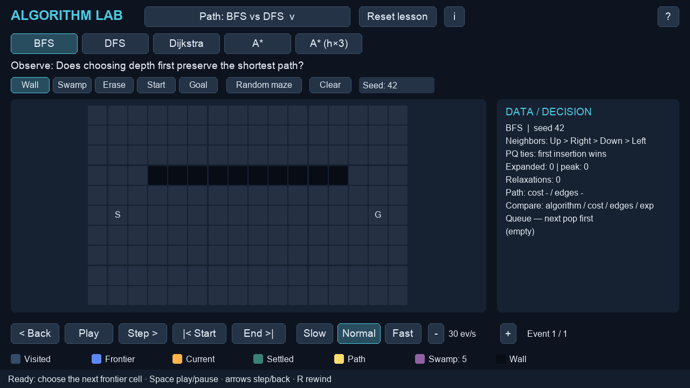

# Algorithm Lab

A Pygame learning app that runs pathfinding, dynamic programming, greedy and bit-manipulation
algorithms one event at a time. Each algorithm is a generator that never imports pygame; the window
only receives its events and draws them. Stepping backward and forward replays and restores the
recorded history of the same input.



## Install and run

Run everything from the project folder. The intended setup for readers is
**CPython 3.12 + the official pygame 2.6.1 wheel**. A clean install of that combination could not be
verified yet because of network restrictions, so the supported range is not final.
Building pygame from source on Python 3.14 is not a recommended install path.

```sh
python3.12 -m venv .venv
.venv/bin/python -m pip install --only-binary=:all: -r requirements.txt
./run.sh
```

### Theme

The default theme is `arcade`, with neon colors and raised buttons. If you prefer the earlier look,
run the `classic` theme. `classic` is pixel-identical to the screens before themes were added
(checked on 60 captures: 20 lessons × main view, help and About).

```sh
./run.sh --theme classic
ALGOVIZ_THEME=classic ./run.sh     # an environment variable works too
```

If you already have a virtual environment, keep it and install into a fresh copy of the project.
Do not copy `.venv` when you move the project.
The [official release files](https://pypi.org/project/pygame/2.6.1/#files) include a CPython 3.12
macOS ARM64 wheel. The app uses pygame (not pygame-ce) and needs no numpy, external API or credentials.

### Development notes

The UI tests, headless smoke test and `verify.sh` ran on Python 3.14.2 / pygame 2.6.1 / SDL 2.32.10
with a **locally patched pygame**: a local pygame build was copied into `.venv`, and a circular import
in its freetype-based `font.py` was fixed inside that copy. This patch is not a recommended install
method for readers. A separate Python 3.12.13 environment could not install the pygame wheel because
PyPI was unreachable (DNS). The pygame-free algorithm tests run there, but that does not replace UI
verification. Neither the global Python environment nor other projects were modified.

## First lesson

The first screen loads the fixed map of **Path: BFS vs DFS**.
Press `BFS` at the top, then press `DFS` when it finishes and compare. Use `End >|` or the End key
to skip waiting. The comparison table on the right collects **cost / edges / expanded** for each
algorithm: BFS takes 13 edges, while DFS dives north and takes 25 edges.
Path lessons have no numbered step buttons; just switch the algorithm button.
Lessons in the other modules keep their step buttons.
Explanations are tucked away behind `i` (About, next to the title) and the shared `?` help.

The lesson menu is grouped into Path / DP / Greedy / Bits. Scroll the mouse wheel inside the menu to
reach the lower Bits lessons. Loading a lesson shows a status message that the current input was
replaced. The same lesson always reproduces the same map and input.

## Controls

| Control | Action |
|---|---|
| Space / Play / Pause | Play or pause; after the end, Play replays the same history |
| → / Step >, ← / < Back | Move one event forward / restore one event |
| End / End >\| | Compute to the end; the history for stepping back is kept |
| R / Start | Jump to the start of the same history |
| Slow / Normal / Fast | 0.5× / 1× / 2× the lesson's default speed |
| ↑ / +, ↓ / − | Fine-tune events per second by 1; range 1..240 |
| Reset lesson | Restore the default input and speed and clear the comparison table |
| Tab / Enter | Move focus between buttons and fields / activate |
| Click a field, then Enter or Apply | Apply the edit; on an error the previous input and history are kept |
| Wheel over the right panel | Scroll long data-structure and table listings |
| i / ? | Lesson background / shared help |
| Esc / click outside a popup | Close the popup; that click is not passed to the controls behind it |

While a popup is open, keys, clicks, wheel and drag behind it are blocked and playback pauses.
Hovering over a step button shows a one-line tooltip.
While editing a field, Space and R are typed as characters. Esc cancels the edit; with no popup,
menu or edit open, Esc quits the app.
Status messages are collected in one bar at the bottom, and errors take priority.

### Speed

Defaults: Path 30 events/s (60 on the open Guided map), DP 12, Greedy coins 10 / meetings 3 / bag 6,
Bits 4 by default (logic and power-of-two 2, negation and clear 3, shift and subsets 1).
A speed you change is kept when you reload that lesson; Reset lesson restores the default.
Defaults aim for 5–15 seconds per representative step based on event counts, but not every step
falls in that range. Short edge cases, DFS, traceback and greedy runs with few choices finish faster;
DP on the largest inputs takes longer.
The measured auto-play time per lesson is recorded under `lesson_stage_timing` in
[verification.json](docs/verification.json). It does not include a person's reading, typing or thinking time.

## Fixed path maps and expected results

| Lesson | Fixed input | Comparison |
|---|---|---|
| BFS vs DFS | 16×10, S=(1,5), G=(14,5), wall at y=3 for x=3..12 | BFS cost 13 / edges 13 / expanded 102, DFS cost 25 / edges 25 / expanded 25 |
| Swamp costs | 16×10, swamp block x=6..9, y=4..6 (entry cost 5) | BFS cost 29 / edges 13 / expanded 111, Dijkstra cost 17 / edges 17 / expanded 150 |
| Guided search | open 24×14, S=(1,7), G=(22,7) | Dijkstra cost 21 / expanded 267, A* cost 21 / expanded 22 |
| Heuristic trap | 16×10, one cell at (7,5) with cost 5 | A* cost 15 / edges 15 / expanded 42, A* (h×3) cost 17 / edges 13 / expanded 14 |

BFS and DFS stop right after the relax event that discovers the goal. Dijkstra and A* stop when the
goal is popped from the priority queue.
Start = goal gives cost 0 and 0 edges; a blocked start or goal, or a disconnected map, shows No path.
BFS minimizes the number of edges, not the swamp cost. DFS only guarantees reachability.
On the default map, DFS stops after expanding 25 cells, right when it discovers the goal, without
draining the rest of the frontier.

Draw on the map with `Wall / Swamp / Erase / Start / Goal`; right-click erases.
`Clear` removes walls and swamps, and `Seed` with `Random maze` reproduces the random map for that seed.
Editing the map resets the comparison table and the history. Random mazes are not guaranteed to be connected.
Weights are positive integers, a cell's cost is paid on entry, and the start cell itself costs 0.
For small cells, and for A*'s g/h/f values, hover over a cell and read the side panel.

### Order and tie-breaking rules

- Neighbors are visited Up → Right → Down → Left. BFS uses a FIFO queue.
- DFS pushes neighbors in reverse so Up is popped first, and **prevents duplicate pushes at discovery**.
  Because pending siblings are marked as discovered early, its visit order and parent tree can differ
  from textbook recursive DFS.
- Dijkstra and A* prefer the entry inserted first when keys tie. Stale entries are shown while they
  are still physically in the priority queue.
- A* uses the Manhattan distance as h; h×1 is admissible and consistent on this positive-weight grid.
  h×3 does not guarantee optimality and reopens a node when a better g is found.
- LCS breaks ties by moving up; the knapsack DP breaks ties by skipping the current item.
- Coin DP breaks ties toward the larger coin; meeting and item-ratio sorting keep the original input order on ties.
- Subsets are listed in ascending mask order; on equal value the earlier mask is kept.

## DP and greedy lessons

| Lesson | Steps | What to observe |
|---|---|---|
| Fibonacci calls | Run naive → Run memo → Compare n=8 | n=6: value 8, 25 vs 11 calls; n=8: value 21, 67 vs 15 calls |
| LCS traceback | Fill table → Trace back → Swap strings | Pause after the table is filled, dependency cells and traceback, the common subsequence of both strings |
| 0/1 knapsack | Fill table → Trace back → Compare greedy | Items (2,12), (4,20), (6,24), capacity 10: items 2+3 for value 44; the same input is shared |
| Coin counterexample | Run greedy → Run optimal → Canonical coins | {1,3,4}, amount 6: greedy 4+1+1 (3 coins), optimal 3+3 (2 coins) |
| Canonical coins | Run greedy → Run optimal → Counterexample | {1,5,10,25}, amount 63: both use 6 coins |
| Earliest start trap | Run start → Run finish → Try duration trap | One long meeting that starts first vs three meetings chosen by earliest finish |
| Shortest meeting trap | Run duration → Run finish → Try start trap | One short meeting in the middle vs two compatible meetings |
| Fractional vs 0/1 | Run ratios → Run optimal → Open DP table | Same input: fractional 48, 0/1 greedy 32, DP 44 |

Tables fit the panel automatically in both directions; **there are no Columns / Amounts buttons and
no wheel scrolling inside tables**. Font sizes stay fixed at 19 px (regular) and 16 px (small).
LCS accepts up to 12 characters per string; the knapsack accepts up to 8 items and a displayed capacity of 25.
The minimum table cell is 28 px wide and 22 px tall; long knapsack values widen the cells and so
lower the capacity that fits. Inputs that do not fit are rejected with an error, keeping the previous
input. The algorithm's own capacity limit (30) is separate from this display limit.
Coins accept amounts 0..150, wrapped at 10 cells per row and shown as `amount: fewest coins`.
The current cell and its dependency cells always stay inside the table.
Fibonacci is limited to n <= 8 so every call node stays readable.

## Bit lessons

W is 4, 8 or 16. Each cell shows a bit and its place value; each row shows decimal and hexadecimal.
Every word and result is masked with `& ((1 << W) - 1)`. Signed is the two's complement reading of the same word.
Python's `~5 == -6` and `>>` on negative numbers follow unbounded integers; the app keeps W-bit
results and raw Python results apart.
Logical right shift fills with 0, arithmetic right shift fills with the sign bit. Panel values follow
the current signed/unsigned view.

| Lesson | Steps | What to observe |
|---|---|---|
| Logic gates | AND → XOR → NOT | 152 and 60: AND 24 / XOR 164 / NOT 103; OR 188 via the operation button |
| Shift and sign | Logical right → Arithmetic right → Shift left | 152 shifted by 2: 38 / word 230 (signed −26) / 96 |
| Two's complement | Negate x → Try zero → Minimum value | 5 → 251 (signed −5), 0 → 0, −128 → the same word 128 |
| Clear and count | Clear once → Count all ones → Try zero | 152 → 144; repeated 152 → 144 → 128 → 0, popcount 3; zero has popcount 0 |
| Isolate lowest one | Isolate x → Try zero → Try odd x | 152 → 8, zero → 0, odd 37 → 1 |
| Power of two | Test x → Try zero → Try power | Default 12 is False, 0 is False thanks to the zero guard, 16 is True |
| XOR singleton | Find singleton → Reorder words → Change example | Pairs cancel, leaving 7; reversing the order still gives 7; the new example gives 11 |
| Subsets and knapsack | List subsets → Use bag input → Open knapsack DP | Best value 44 over 8 subsets; compare the same items and capacity in the DP |

`Use bag input` loads the user input from the earlier DP/greedy lessons; if you never changed the
default input, it brings back the same input. `Reorder words` does not change the answer; it shows
that the result stays the same when the accumulation order changes.
The power-of-two lesson uses different defaults for Test x and Try power (12 vs 16) so the two steps differ.
For XOR, exactly one word must appear once after masking and every other word twice.
Subsets support up to 8 items, with n <= W.

## Project layout

```text
algoviz/
  engine.py       events, Timeline, undo
  pathfinding.py  path-search generators, deterministic frontier
  dp.py           Fibonacci, LCS, 0/1 knapsack generators
  greedy.py       coins, meetings, fractional vs 0/1 generators
  bits.py         W-bit generators
  app.py          UI, input, playback, auto-fit, popups
  bits_view.py    bit-lesson UI
  lessons.py      20 lessons, speeds, fixed maps
  education.py    About, tooltip and help text
  theme.py        arcade / classic color themes
  capture.py      PNG saving
 tests/fixtures/pathfinding.py.txt  earlier weighted-search snapshot used as a reference
 tools/verify.py                   captures, lesson play time and frame measurements
 tools/benchmark_end.py            80×60 End benchmark
 docs/                             verification records and screenshots
```

## Verification

```sh
./verify.sh
# Optional screenshot
mkdir -p exports
./run.sh --headless --lesson 7 --finish --frames 3 --screenshot exports/coin.png
```

The full suite has **55 tests**, run by `./verify.sh`. An earlier run log is in
[usability-verify-output.txt](docs/usability-verify-output.txt).

| Area | Independent reference / regression check |
|---|---|
| Paths | 400 small random grids (seed 9031): Dijkstra/A* cost vs Bellman-Ford; unweighted BFS cost and DFS reachability |
| Path stopping and lessons | BFS/DFS done right after the goal relax, weighted search done after the goal pop; start = goal and blocked goal included; the claims of all four maps are pinned |
| LCS and knapsack | 250 small inputs each, compared with full subsequence and subset enumeration |
| Fibonacci | Naive call count 2F(n+1)−1; memoized 2n−1 for n >= 2 |
| Greedy | Coins, meetings and bag compared with independent exhaustive search; failure examples pinned |
| Bits | AND/OR/XOR on all 65,536 pairs each vs digit-list arithmetic; every 8-bit shift 0..8, negation and trick; 4- and 16-bit edge cases |
| History | For every algorithm, all states are stepped back and forward again and compared; the weighted frontier is compared with the earlier snapshot fixture |
| UI | Real injected Pygame events across 20 lessons (path algorithm buttons, 48 steps elsewhere): resize, Tab/Enter, input errors, popups, tooltips, remembered speed |
| Tables | LCS with 12 characters each, 8 items / capacity 25, amount 150, drawn at every event: every cell, dependency and current-cell rectangle stays inside at both resolutions |

The numbers and properties in the About popups were checked against the independent reference tests above.
The general complexity figures exclude recording and rendering costs, and the guarantees of safe A*
are not claimed for the reopening h×3 search. The Python bit explanations were checked against the
[official documentation on bitwise operations on integers](https://docs.python.org/3/library/stdtypes.html#bitwise-operations-on-integer-types).

[Screen review](docs/SCREEN_REVIEW.md), [raw measurements](docs/verification.json) and the
[PNG manifest](docs/capture-manifest.json) are kept together.
The 1280×720 and 1366×768 layouts are verified with headless captures and injected input events,
not reported as hands-on desktop use. The End button and the algorithm comparison table shorten the
lesson flow toward the three-minute usability goal, but testing with real beginners is still pending.

### Performance

Instead of copying and sorting the whole frontier at every event, the history records only added and
removed entries; the actual pop order is built when drawing. For 80×60 Dijkstra, the first
before/after measurement went from 1.3706 s to 0.0786 s, and the tracemalloc peak Python allocation
from 56,186,592 to 10,691,616 bytes.
The [before](docs/end-before.json), [first improvement](docs/end-after-initial.json) and
[latest re-measurement](docs/end-after.json) are kept; `end_80x60` in verification.json separates
before / initial_after / after. The 300-frame tick + draw + dummy display.flip measurement excludes
waiting time and does not guarantee real GPU performance or 60 fps across the whole run.

### Known limitations

- A clean install of the official pygame, real macOS / HiDPI / trackpad use, other operating systems and
  the three-minute usability goal for beginners are not verified yet.
- The history uses memory in proportion to the number of events; algorithm complexity figures do not include recording or drawing.
- Playing the largest inputs takes longer than the small default lessons. Use End to see the result, or change the speed.
- Long right-panel listings scroll, and long field previews are shortened. Bit results are split into decimal and hexadecimal lines.

## License

MIT. See [LICENSE](LICENSE).
